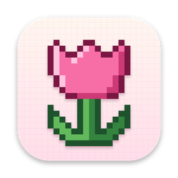
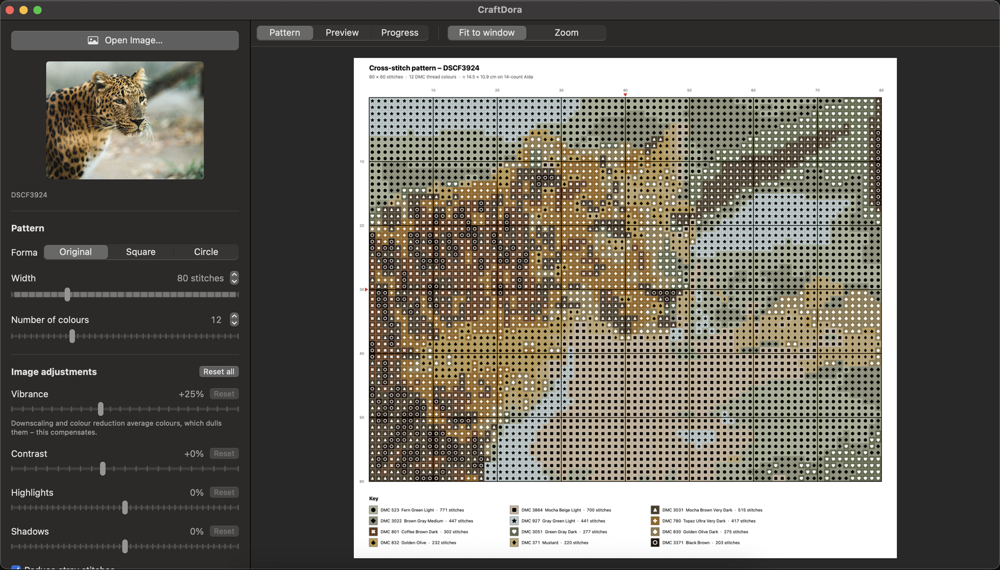
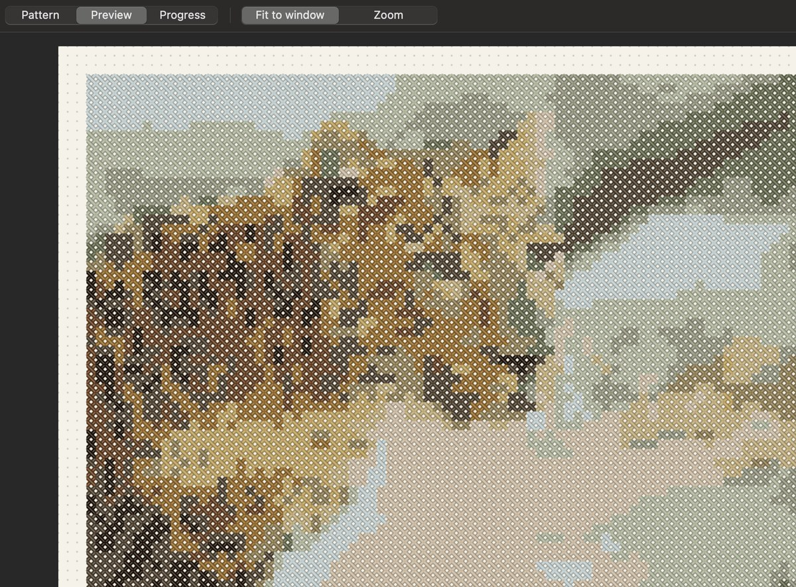
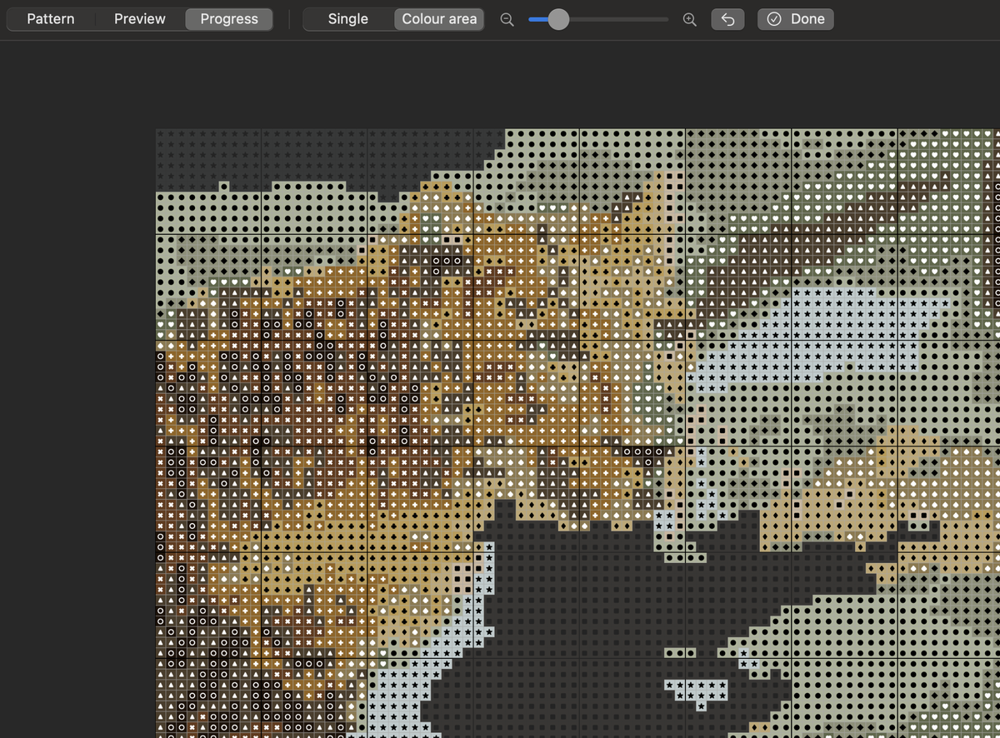
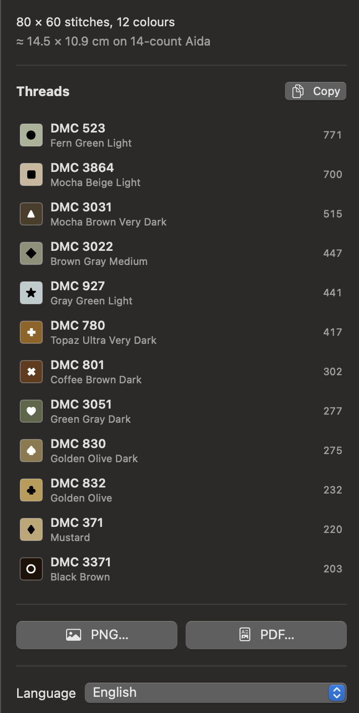

<p align="center">
  
</p>

<h1 align="center">CraftDora</h1>

<p align="center">
  <b>Turn your photos into cross-stitch patterns – free, offline, on your Mac.</b><br>
  Created by <a href="https://zsolthoffmann.com">Zsolt Hoffmann</a> · <a href="https://www.instagram.com/zsolthoffmanncom">Instagram</a>
</p>

<p align="center">
  
  
  
  
</p>

---

## Why CraftDora?

I'm a photographer. I spend my days thinking about light, colour and the moments worth keeping – and I've always admired how cross-stitchers turn those same moments into something you can hold, one tiny X at a time.

Most pattern makers are online services, subscriptions or apps that want an account and an internet connection. I wanted the cross-stitch community to have an option that is **completely free, works offline and keeps your photos on your own computer**.

We live in the age of AI, where images can be generated in seconds. CraftDora goes the other way: it uses the computer only to prepare the chart, so that **people can create something slow, personal and handmade**. If it helps even one new piece of embroidery come into the world, it has done its job.

## Features

**From photo to pattern**
- Open any image (JPEG, PNG, HEIC, …) or simply drag it onto the window
- Set the **width in stitches** (10–300) and the **number of colours** (2–40)
- **Shape:** original aspect ratio, **square (1:1)** or **circle** – drag and zoom to choose the crop
- **Image adjustments:** vibrance, contrast, highlights and shadows, applied *before* colour reduction, so thread choices follow your edits
- **Stray stitch reduction** – removes lonely single stitches that are tedious to sew

**Real thread colours**
- Matches every colour to the closest of **454 DMC threads**, using the CIEDE2000 colour-difference formula, which is designed to follow human perception
- Thread list with DMC code, name and stitch count – one click copies it as a shopping list

**Clear, printable charts**
- Every colour gets its own **distinct symbol** (●, ■, ▲, ◆, ★ …), so the chart works in colour *and* in black-and-white
- Bold lines every 10 stitches, row and column numbers, centre markers
- Export as **PNG** or as a **printable A4 PDF** – page 1 is an overview with the key, followed by the chart split into numbered pages
- Estimated finished size on 14-count Aida

**See it before you stitch it**
- **Preview** shows roughly how the finished piece will look: shaded cross stitches on Aida fabric, circles shown in a wooden hoop

**Track your progress**
- **Progress** view: click or drag over finished stitches, or mark a whole connected colour area with a single click
- Finished areas fade away, so only what's left is visible – press **⌘K** to show them again with a green tick
- Highlight one colour at a time, mark a whole colour as done, undo with **⌘Z**
- Progress is saved automatically and restored when you reopen the same image with the same settings

**Everything else**
- English and Hungarian interface (follows your Mac's language; can be changed in the sidebar)
- 100% offline – no account, no tracking, no network access

## Screenshots

<p align="center">
  
  <br><em>Pattern view – settings on the left, the chart with symbols and the DMC key on the right</em>
</p>

<table>
  <tr>
    <td width="50%"></td>
    <td width="50%"></td>
  </tr>
  <tr>
    <td align="center"><em>Preview – roughly how it will look stitched</em></td>
    <td align="center"><em>Progress – finished areas fade away</em></td>
  </tr>
</table>

<p align="center">
  
  <br><em>Thread list with DMC codes and stitch counts</em>
</p>

<p align="center"><sub>Sample photo (leopard) © Zsolt Hoffmann – see more of my photography at <a href="https://zsolthoffmann.com">zsolthoffmann.com</a> and on Instagram <a href="https://www.instagram.com/zsolthoffmanncom">@zsolthoffmanncom</a></sub></p>

## Download & install

**Requirements:** a Mac with **Apple silicon** (M1, M2, M3, M4 …) and **macOS 12 Monterey or later**. Intel Macs are not supported yet.

1. Download **`CraftDora.dmg`** from the [**Releases**](../../releases) page.
2. Open the DMG and drag **CraftDora** into your **Applications** folder.
3. **The first time you open it, macOS will warn you** that it can't verify the app. This is expected: CraftDora is a free, independent project and isn't signed with a paid Apple Developer ID. To open it anyway:
   - **macOS 15 Sequoia and later:** try to open CraftDora once, then go to **System Settings → Privacy & Security**, scroll down and click **Open Anyway** next to the CraftDora message. Confirm with your password.
   - **macOS 12–14:** right-click (or Control-click) CraftDora in Applications, choose **Open**, then click **Open** in the dialog.
   - **Or, in Terminal:**
     ```bash
     xattr -dr com.apple.quarantine /Applications/CraftDora.app
     ```

You only need to do this once. The full source code is right here, so you can check exactly what the app does – or build it yourself.

## Build from source

You need the Xcode Command Line Tools (the full Xcode app is not required):

```bash
xcode-select --install
git clone <this repository>
cd CraftDora
bash build.sh
```

The script compiles the app, signs it ad hoc for your own Mac and creates `build/CraftDora.app` and `build/CraftDora.dmg`. You can also double-click **`Build DMG.command`** in Finder.

Apps you build yourself don't trigger the Gatekeeper warning on your own Mac.

## How to use

1. **Open an image** – click *Open Image…* (⌘O) or drop a photo onto the window.
2. **Choose the shape** – Original, Square or Circle. For square and circle, drag the frame on the thumbnail and use *Crop zoom* to pick the part you want.
3. **Set the size and colours** – the width in stitches decides the finished size (see the estimate in the sidebar); fewer colours means an easier project.
4. **Fine-tune the image** – vibrance, contrast, highlights and shadows. Faded or hazy photos often benefit from +15–25% contrast.
5. **Check the Preview** to see how it will look stitched.
6. **Export** – *PNG…* (⌘S) or *PDF…* (⌘E) for printing. Copy the thread list for shopping.
7. **Stitch!** Switch to **Progress** and mark what you've finished as you go.

**Tips**
- Simple subjects with clear shapes and good contrast give the best results: portraits with a plain background, flowers, pets, logos and pixel art.
- On 14-count Aida, 100 stitches are about 18 cm (7 in).
- Screens and threads never match perfectly – compare with a real DMC colour card before buying.

## Privacy

CraftDora never connects to the internet. Your images are processed only on your Mac and are never uploaded anywhere. The only data it stores is your stitching progress, in `~/Library/Application Support/CraftDora/Progress`, plus a few preferences (language, view options).

## How CraftDora was made

CraftDora is my idea and my project – the concept, the features, the look and every design decision come from me, a photographer with a clear picture of what the cross-stitch community could use.

I built it together with **Claude**, Anthropic's AI assistant, which wrote the Swift code based on my direction. Step by step I described what I wanted – the shapes and crop, the image adjustments, the DMC thread matching, the stitched preview, the way finished stitches should disappear in the progress view, the pink tulip icon – tested the ideas, and asked for changes until it worked the way I imagined. It's a good example of how AI can serve human creativity instead of replacing it: the tool is digital, but what it's for is handmade.

## Please credit & share ❤️

CraftDora is free, and it will stay free. I'm an independent photographer, not a company, so the best way to support the project is to **help it reach people**:

- ⭐ **Star this repository** – it helps others find it.
- 🧵 **Share what you make!** If you post a pattern or a finished piece made with CraftDora, I'd be really grateful for a mention, for example:
  > Pattern made with **CraftDora** by Zsolt Hoffmann – zsolthoffmann.com

  On Instagram, tag **[@zsolthoffmanncom](https://www.instagram.com/zsolthoffmanncom)** and use the hashtag **#CraftDora**, so I can find and admire your work.
- 💬 **Tell a friend** or share it in your favourite cross-stitch group.

For someone working on their own, every mention means a lot. Thank you!

## About me – Zsolt Hoffmann, photographer

When I'm not building tools like this, I'm behind the camera. If you enjoy images – the kind that might even become your next cross-stitch project – please visit my portfolio at **[zsolthoffmann.com](https://zsolthoffmann.com)** and follow me on Instagram at **[@zsolthoffmanncom](https://www.instagram.com/zsolthoffmanncom)**. I'd love to have you there.

## Feedback & contributing

Found a bug or have an idea? Please open an [issue](../../issues). Pull requests are welcome too, especially translations into more languages.

CraftDora is a personal, non-commercial project maintained in my free time, so replies may take a little while – thank you for your patience.

## License

**CraftDora** © 2026 Zsolt Hoffmann – [zsolthoffmann.com](https://zsolthoffmann.com)

CraftDora is free software, licensed under the **GNU General Public License v3.0** – see [LICENSE](LICENSE). You may use, study, share and modify it. If you distribute it or a modified version, you must keep the copyright notice and release your changes under the same licence.

The DMC thread colour data comes from [sharlagelfand/dmc](https://github.com/sharlagelfand/dmc) (MIT licence) – see [THIRD_PARTY_NOTICES.txt](THIRD_PARTY_NOTICES.txt).

*“DMC” is a trademark of DMC Corporation. CraftDora is not affiliated with, endorsed by or sponsored by DMC Corporation.*
